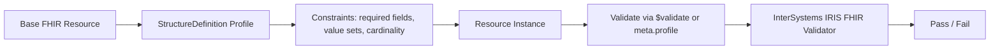

# Implementing FHIR Profiles in InterSystems IRIS

This is a concise self-learning note based on the article "Implementing FHIR Profiles in IRIS".

## 1) What is a FHIR profile?

A FHIR profile is a constrained version of a base resource such as `Patient`, `Observation`, or `Medication`.

- Base FHIR is generic and broad.
- A profile adds rules for a specific use case, hospital, region, or workflow.
- The goal is not to replace FHIR, but to make the data more precise and interoperable.

Examples of profile rules:

- required fields
- allowed cardinality
- fixed values or patterns
- allowed coded values (`ValueSet`)
- required extensions
- slicing for repeating elements

## 2) Why profiles matter

A valid FHIR resource must be structurally correct. A profile adds clinical and implementation-specific validation.

For example:

- `Patient.gender` may be allowed in base FHIR but restricted locally to only `male` and `female`
- `Patient.identifier` may require a national ID or MRN
- `Observation.code` may be limited to approved local codes

This is how organizations enforce consistency without changing the base standard.

## 3) Core FHIR artifacts

### StructureDefinition
The profile itself. It defines the rules.

Key fields:

- `url`: canonical identifier
- `baseDefinition`: base resource or parent profile
- `derivation`: usually `constraint`
- `snapshot` and `differential`: flattened or delta rules

### ValueSet
Defines allowed values for a coded element.

### CodeSystem
Defines all possible codes and meanings.

### Extension
Adds extra fields without altering the base resource.

## 4) Common profile patterns

### Required fields

```json
{
  "resourceType": "StructureDefinition",
  "url": "http://example.org/fhir/StructureDefinition/FinalPatient",
  "name": "FinalPatient",
  "type": "Patient",
  "baseDefinition": "http://hl7.org/fhir/StructureDefinition/Patient",
  "derivation": "constraint",
  "differential": {
    "element": [
      { "id": "Patient.identifier", "path": "Patient.identifier", "min": 1 },
      { "id": "Patient.name", "path": "Patient.name", "min": 1 },
      { "id": "Patient.gender", "path": "Patient.gender", "min": 1 }
    ]
  }
}
```

### ValueSet binding

```json
{
  "id": "Patient.gender",
  "path": "Patient.gender",
  "min": 1,
  "max": "1",
  "binding": {
    "strength": "required",
    "valueSet": "http://example.org/fhir/ValueSet/local-gender"
  }
}
```

### Using a profile in a resource

Preferred method:

```json
{
  "resourceType": "Patient",
  "meta": {
    "profile": [
      "http://hl7.org/fhir/us/core/StructureDefinition/us-core-patient"
    ]
  }
}
```

## 5) Validation in FHIR: how to apply a profile

FHIR validation can happen through:

- `?_profile=...` during search/filtering
- `$validate` for actual validation
- `meta.profile` inside the resource itself

Important IRIS note:

- InterSystems IRIS requires a versioned profile URL for validation.
- Example:

```text
POST /Patient/$validate?profile=http://example.org/fhir/StructureDefinition/FinalPatient|1.0.0
```

Without the version, validation may fail.

## 6) Profiling in InterSystems IRIS

IRIS supports FHIR profile-based validation with the FHIR validation server.

Preconditions:

- FHIR R4
- Java 11 installed
- FHIR validation service enabled

### Import flow

1. Create a package manifest (`package.json`)
2. Add the `StructureDefinition` JSON
3. Place both files in the same directory
4. Import into IRIS
5. Validate resource against the profile

Example package manifest:

```json
{
  "name": "finalpatient.profile",
  "version": "1.0.0",
  "dependencies": {
    "hl7.fhir.r4.core": "4.0.1"
  }
}
```

## 7) A simple mental model



## 8) Key takeaways

- A FHIR profile is a constraint layer on a base resource.
- It improves interoperability, governance, and validation.
- `StructureDefinition` is the main artifact.
- `ValueSet` and `CodeSystem` support constrained coding.
- In IRIS, profile validation is version-aware and depends on the FHIR validation service.

## 9) Quick checklist

- Do I need a narrower set of rules than the base FHIR standard?
- Is the profile tied to a specific workflow or local code list?
- Have I defined `url`, `baseDefinition`, and `derivation`?
- Is the validation URL versioned for IRIS?
- Am I validating with `meta.profile` or `$validate`?

This is enough to start implementing and reasoning about FHIR profiles in IRIS without getting lost in the full specification.
